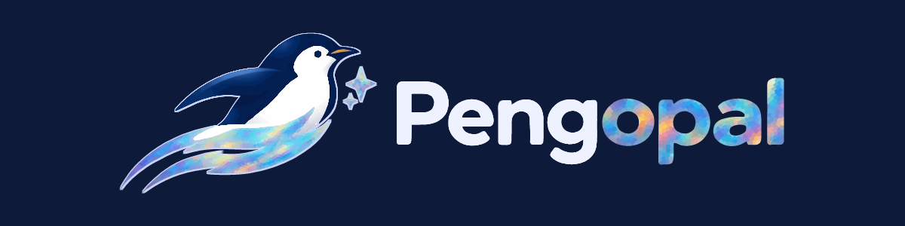
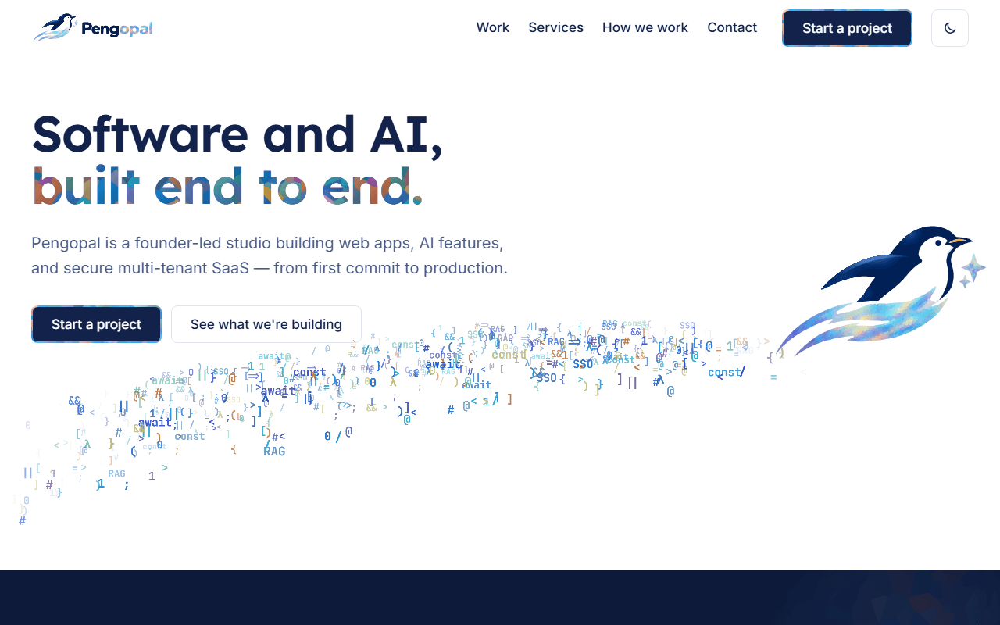
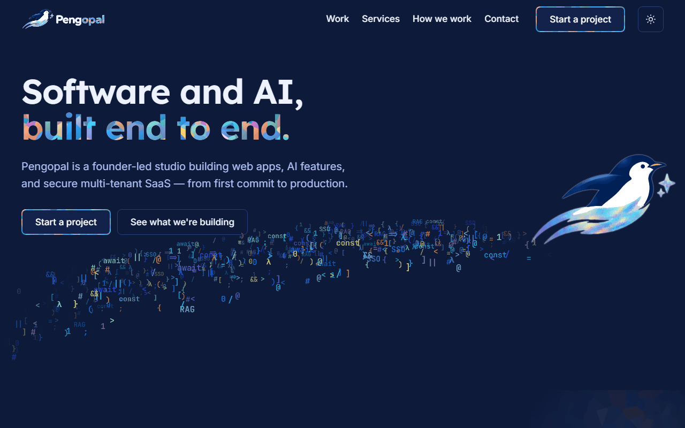
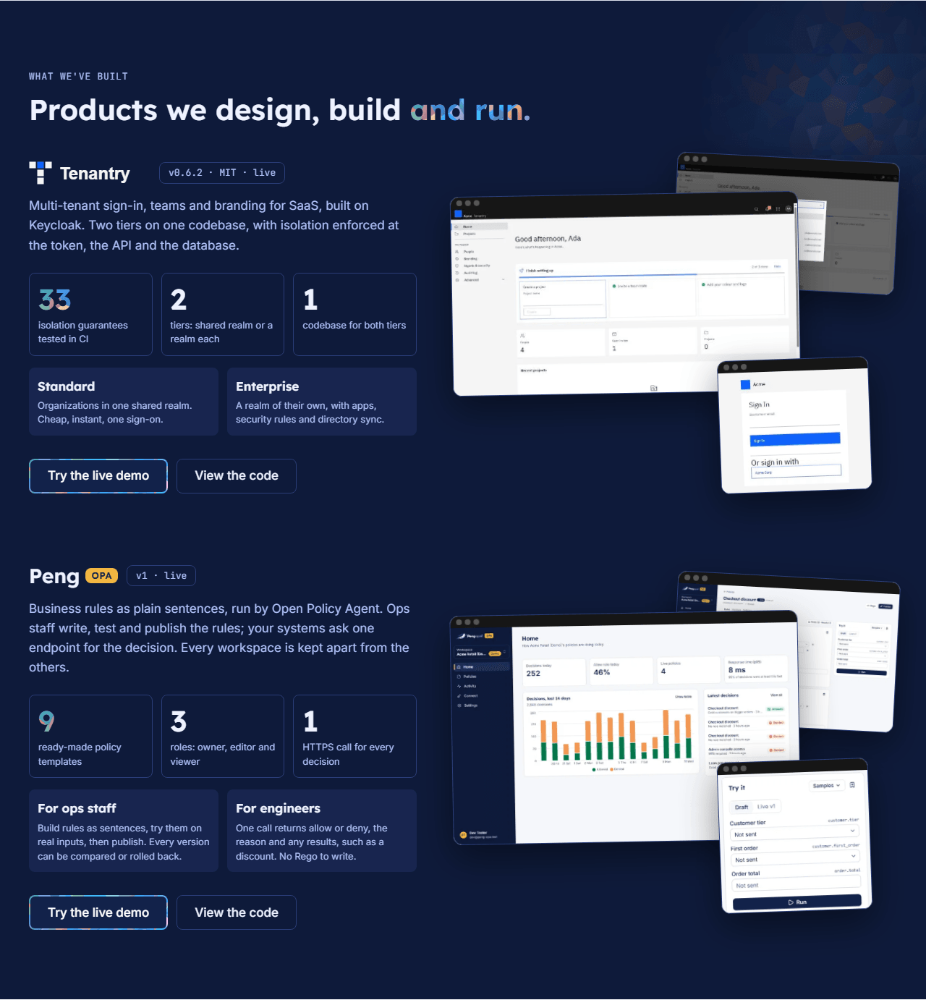
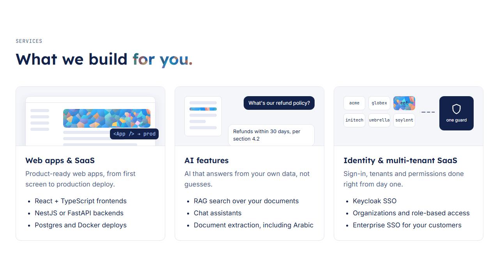
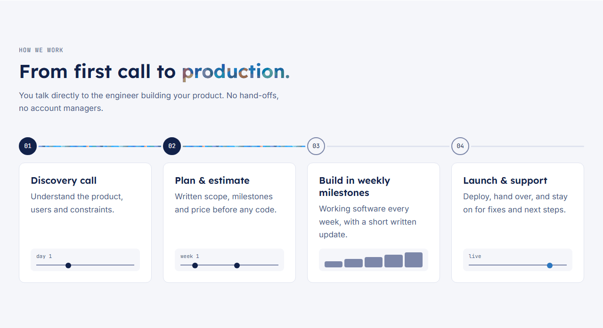
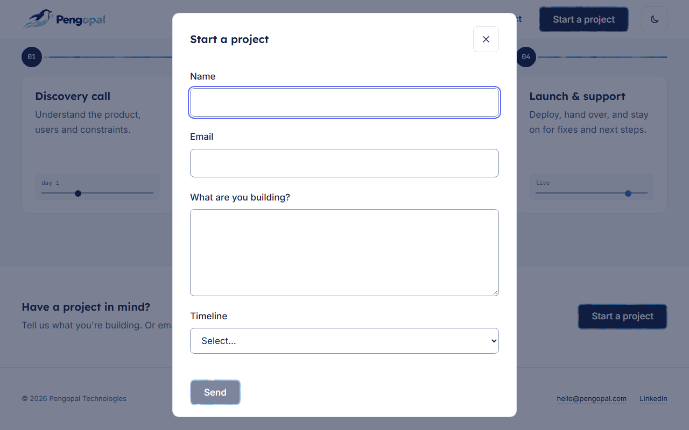
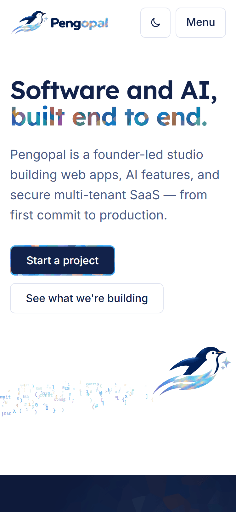
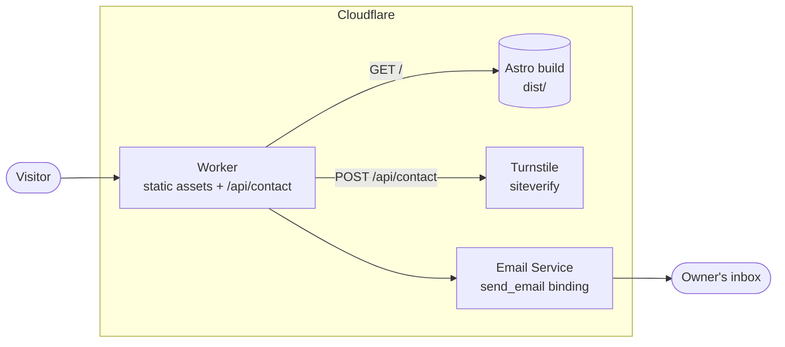

<div align="center">



**The company site for Pengopal, a founder-led studio building web apps, AI features and secure multi-tenant SaaS.**

<sub><b>Built with</b></sub><br>

[](https://astro.build/)
[](https://www.typescriptlang.org/)
[](https://threejs.org/)
[](https://workers.cloudflare.com/)
[](https://www.cloudflare.com/products/turnstile/)
[](https://vitest.dev/)
[](https://playwright.dev/)
[](https://github.com/dequelabs/axe-core)
[](https://github.com/GoogleChrome/lighthouse-ci)

</div>



## What it is

A single page that shows what Pengopal builds. It leads with real work, not borrowed credibility: no stock photos, invented stats, testimonials or client logos. Everything shown is real, or clearly labelled as reserved.

The brand comes straight from the logo. The penguin's opal wake becomes a live 3D stream of code, and the opal colours are sampled from the logo's pixels, never hand-picked.

## Features

### A code stream from the penguin's wake

The hero's opal wake becomes a stream of code characters in real 3D depth (Three.js). The stream tilts with the mouse, and characters ease aside from the cursor.

**The page always paints first.** A server-rendered still of the same stream appears before any JavaScript runs. The 3D starts only after load, on desktop, with motion allowed and WebGL available. Everyone else keeps the still version.

### The Opal Mosaic

The highlighted words and the primary buttons use **Opal Mosaic**, a faceted texture generated from the real pixels of the logo's "opal" letters.

- A test checks that 95% of the texture reaches 3:1 contrast on white and on navy.
- A gradient fallback keeps the text visible if the texture never loads.

The primary button is navy with white text (15.5:1) and a drifting mosaic border.



### What we've built

A feature band for the studio's own products. It currently shows [**Tenantry**](https://github.com/mfurqanwork/tenantry-keycloak-multitenancy), multi-tenant sign-in on Keycloak, with:

- real screenshots;
- facts taken only from its README;
- links to the [live demo](https://tenantry.pengopal.com) and the code.

Projects are typed data in `src/content/site.ts`, so the next one is a data entry, not a redesign.



### Services, as small scenes

Each service has a small scene that plays once when it scrolls into view:

- an app window shipping to production;
- an assistant answering from a document;
- tenants wired through one guard.

The scenes are decorative and hidden from assistive technology. The headings and lists carry the meaning.



### How we work

A showcase timeline: horizontal on desktop, vertical on phones. Its opal rail draws as you scroll, only ever grows, and survives a resize across the breakpoint.



### A contact form that never loses an enquiry

A quiet band opens the form in a native dialog. The Cloudflare Turnstile spam check loads only when the dialog first opens.

The form is a Cloudflare Worker. It:

- validates every field;
- rejects line breaks in header fields (no email header injection);
- counts characters the way people do (one emoji is one character);
- emails the enquiry to the owner's inbox.

On any failure, the visitor gets a ready-filled email link instead. Without JavaScript, the form folds out in the band.

<p align="center"> </p>

## Quality

A small test suite covers what would actually hurt if it broke, and runs on every push:

| Check | Tool | Tests |
| --- | --- | --- |
| Contact Worker: sends a valid enquiry, rejects bad input and header injection, blocks failed spam checks, reports mail failures, www → apex redirect | Vitest | 5 |
| The page loads cleanly and fits a phone, the form sends, a failed send offers the email link, 404 / robots / sitemap | Playwright (Chromium) | 4 |
| Accessibility: WCAG 2.1 AA in light and dark | axe + Playwright | 1 |
| Types | `astro check` + `tsc` | 0 errors |

Lighthouse is run by hand before big changes (last run: 96 performance · 100 accessibility · 100 best practices · 100 SEO).

## Architecture



- **The page is static.** Astro renders everything at build time. JavaScript adds only the 3D stream, motion, the dialog and the form.
- **One Worker** serves the assets and handles `POST /api/contact`. The handler is a pure function with injected Turnstile and mail dependencies, so it is unit-tested without Cloudflare.
- **Secrets never live in the repository:** `TURNSTILE_SECRET` and `CONTACT_TO` are Worker secrets.

## Where things live

| What | Where |
| --- | --- |
| All page text, links and project data | `src/content/site.ts` |
| Colours, type, spacing, motion, the mosaic | `src/styles/tokens.css` |
| Shared styles (buttons, opal text, focus ring) | `src/styles/global.css` |
| One component per section, plus the service scenes | `src/components/`, `src/components/scenes/` |
| The 3D code stream (the only file that imports three.js) | `src/codestream/mount.ts` |
| Motion helpers (reveal, scenes, timeline rail) | `src/motion/` |
| Contact form server side | `worker/` |
| Brand asset generators | `scripts/` |
| Design specs and implementation plans | `docs/superpowers/` |

## Try it locally

You need Node 22.12 or newer. Astro is pinned to 7.3.8, because 7.4+ needs Node 22.23.4.

```bash
npm install
```

```bash
npm run dev
```

Then open <http://localhost:4321>. The contact form needs the Worker; to run it locally:

```bash
npm run build && npx wrangler dev
```

### Tests

```bash
npx playwright install chromium
```

```bash
npm run check && npm test
```

```bash
npm run build && npm run test:e2e && npm run lhci
```

### Brand assets

All of these are generated, never hand-edited:

```bash
npm run assets                      # Opal Mosaic texture, dark logo, share image
```

```bash
node scripts/sample-palette.mjs     # code-stream colours, sampled from the logo
```

```bash
node scripts/import-tenantry.mjs    # Tenantry logo and screenshots
```

```bash
node scripts/readme-images.mjs      # the images in this README
```
